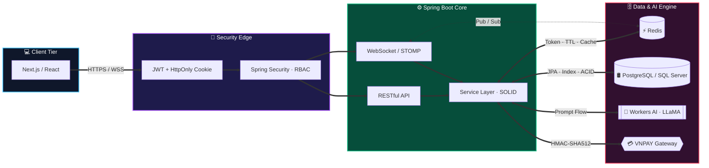

<!-- ╔══════════════════════════════════════════════════════════════════╗ -->
<!-- ║                    1. CINEMATIC HEADER                           ║ -->
<!-- ╚══════════════════════════════════════════════════════════════════╝ -->

  

  

  
  
  
   
  
  
  
  
  

<!-- ╔══════════════════════════════════════════════════════════════════╗ -->
<!-- ║                    2. ABOUT ME                                   ║ -->
<!-- ╚══════════════════════════════════════════════════════════════════╝ -->
<h2 align="center">👨‍💻 About Me</h2>

<table width="100%">
  <tr>
    <td width="40%" align="center" valign="middle">
      
    </td>
    <td width="60%" valign="top">
      <h3>👋 Hi, I'm Chiến!</h3>
      
A <b>Backend Developer</b> who loves building secure, scalable systems and turning AI into real, useful products.

      
💼 <b>Role</b> Fresher / Junior Backend Developer

      
🎓 <b>Education</b> Senior IT Student (23T2) @ <b>UTE – University of Da Nang</b>

      
🌐 <b>Experience</b> Network &amp; Infrastructure Intern @ <b>VNNIC</b> (Central Branch) DNSSEC · RPKI · BGP · Network Security

      
💡 <b>Philosophy</b> Clean code · SOLID · Secure by default

      
🎯 <b>Goal</b> Internship / Full-time role as a <b>Java Spring Boot Backend Developer</b>

    </td>
  </tr>
</table>

  
  
  
  

<!-- ╔══════════════════════════════════════════════════════════════════╗ -->
<!-- ║                    3. HALL OF FAME                               ║ -->
<!-- ╚══════════════════════════════════════════════════════════════════╝ -->
<h2 align="center">🏆 Hall of Fame</h2>

<i>4 awards in a single year — turning ideas into winning products.</i>

<table align="center" width="100%">
  <tr>
    <td align="center" width="25%">
      <h1>🥇</h1>
      <b>1st Place — Champion</b> 
      SURF 2026 Startup Competition  
      
    </td>
    <td align="center" width="25%">
      <h1>🥇</h1>
      <b>1st Place — Champion</b> 
      CYE Junior Vietnam 2026  
      
    </td>
    <td align="center" width="25%">
      <h1>🥉</h1>
      <b>3rd Place — Winner</b> 
      Global Hackathon Da Nang 2026  
      
    </td>
    <td align="center" width="25%">
      <h1>🌟</h1>
      <b>Special Prize</b> 
      Startup Ideas UTE 2026  
      
    </td>
  </tr>
</table>

<!-- ╔══════════════════════════════════════════════════════════════════╗ -->
<!-- ║                    4. JOURNEY TIMELINE                           ║ -->
<!-- ╚══════════════════════════════════════════════════════════════════╝ -->
<h2 align="center">🧭 My Journey</h2>

<table align="center" width="100%">
  <tr>
    <th width="18%">📅 When</th>
    <th width="30%">📍 Milestone</th>
    <th width="52%">✨ Highlights</th>
  </tr>
  <tr>
    <td align="center"><code>2023</code></td>
    <td>🎓 Joined <b>UTE – UDN</b></td>
    <td>Started B.Eng. in Information Technology — fell in love with Java &amp; backend.</td>
  </tr>
  <tr>
    <td align="center"><code>2024</code></td>
    <td>☕ Spring Boot deep-dive</td>
    <td>Built <b>ChienCINEMA</b> with seat-locking concurrency &amp; VNPAY payment gateway.</td>
  </tr>
  <tr>
    <td align="center"><code>2025</code></td>
    <td>⚡ Real-time &amp; Security</td>
    <td>Shipped <b>Messenger Clone</b> — JWT rotation, Redis blacklist, WebSocket/STOMP.</td>
  </tr>
  <tr>
    <td align="center"><code>2026</code></td>
    <td>🌐 Intern @ <b>VNNIC</b></td>
    <td>Hands-on with DNSSEC, RPKI, BGP &amp; Internet infrastructure security.</td>
  </tr>
  <tr>
    <td align="center"><code>2026</code></td>
    <td>🏆 Award season</td>
    <td>2× Champion · 1× Hackathon podium · 1× Special Prize · Launched <b>AI Requirements Analyst</b>.</td>
  </tr>
  <tr>
    <td align="center"><code>Next</code></td>
    <td>🚀 <b>Your team?</b></td>
    <td>Ready to contribute to production-grade enterprise systems. <a href="mailto:chientranminh355@gmail.com">Let's talk →</a></td>
  </tr>
</table>

<!-- ╔══════════════════════════════════════════════════════════════════╗ -->
<!-- ║                    5. TECH ARSENAL                               ║ -->
<!-- ╚══════════════════════════════════════════════════════════════════╝ -->
<h2 align="center">🛠️ Tech Arsenal</h2>

  <b>⚙️ Backend &amp; Languages</b>  
  
    
  <b>🎨 Frontend</b>  
  
    
  <b>🗄️ Data · ☁️ Cloud · 🧰 Tooling</b>  
  

 

<table width="100%">
  <tr>
    <td width="50%" valign="top">
      <h4>☕ Backend Core &amp; Security</h4>
      <ul>
        <li><b>Framework:</b> Spring Boot, Spring MVC, Spring Data JPA / Hibernate</li>
        <li><b>Security:</b> Spring Security, RBAC, JWT rotation, HttpOnly Cookies</li>
        <li><b>Real-time &amp; APIs:</b> RESTful APIs, WebSocket, STOMP protocol</li>
        <li><b>Network Security:</b> DNSSEC, RPKI, BGP fundamentals (VNNIC)</li>
        <li><b>Architecture:</b> Clean Architecture, SOLID Principles</li>
      </ul>
    </td>
    <td width="50%" valign="top">
      <h4>🗄️ Data, DevOps &amp; Cloud</h4>
      <ul>
        <li><b>Databases:</b> PostgreSQL, Microsoft SQL Server, MySQL</li>
        <li><b>DB Design:</b> Indexing, Transactions, ACID Compliance</li>
        <li><b>Caching &amp; Messaging:</b> Redis (Caching, Token Blacklisting, Pub/Sub)</li>
        <li><b>DevOps &amp; Containers:</b> Docker, Docker Compose, Git / GitHub</li>
        <li><b>Cloud &amp; Tooling:</b> Cloudflare Workers AI, Vercel, Postman</li>
      </ul>
    </td>
  </tr>
</table>

<!-- ╔══════════════════════════════════════════════════════════════════╗ -->
<!-- ║                    6. FEATURED PROJECTS — 2×2 GRID               ║ -->
<!-- ╚══════════════════════════════════════════════════════════════════╝ -->
<h2 align="center">🚀 Featured Projects</h2>

<table width="100%">
  <tr>
    <td width="50%" valign="top">
      <h3>🤖 AI Requirements Analyst</h3>
      <b>SaaS Platform · AI-powered Business Analysis</b>
      
Automates requirement extraction &amp; User Story analysis for Business Analysts using <b>Cloudflare Workers AI (LLaMA)</b> on top of a Spring Boot backend.

      
      

        
<b>✨ Key highlights</b>

        <ul>
          <li>Prompt-flow pipeline turning raw docs → structured User Stories</li>
          <li>Zustand state management, responsive Next.js UI</li>
          <li>Dockerized backend, deployed on Vercel edge</li>
        </ul>
      

      

        
      

    </td>
    <td width="50%" valign="top">
      <h3>💬 Real-Time Messenger</h3>
      <b>High-concurrency Chat System</b>
      
Instant messaging backend with <b>WebSocket/STOMP</b> bidirectional channels, JWT HttpOnly cookie rotation &amp; Redis-backed token caching.

      
      

        
<b>✨ Key highlights</b>

        <ul>
          <li>Access/Refresh token rotation with Redis blacklist</li>
          <li>Redis Pub/Sub for horizontally scalable messaging</li>
          <li>Online presence, typing indicators, read receipts</li>
        </ul>
      

      

        
      

    </td>
  </tr>
  <tr>
    <td width="50%" valign="top">
      <h3>🎬 ChienCINEMA</h3>
      <b>Movie Booking · VNPAY Payment Gateway</b>
      
End-to-end cinema reservation with <b>concurrent seat-locking</b> (zero double-booking), showtime management &amp; secure VNPAY checkout.

      
      

        
<b>✨ Key highlights</b>

        <ul>
          <li>Pessimistic / optimistic locking to prevent race conditions</li>
          <li>HMAC-SHA512 signed VNPAY transactions &amp; IPN callback</li>
          <li>Admin dashboard for movies, rooms &amp; showtimes</li>
        </ul>
      

      

        
      

    </td>
    <td width="50%" valign="top">
      <h3>🌐 chientech.id.vn</h3>
      <b>Personal Developer Hub</b>
      
My digital home — technical writings, system architecture breakdowns, full-stack case studies &amp; ongoing engineering explorations.

      
      

        
<b>✨ Key highlights</b>

        <ul>
          <li>Interactive, animated portfolio experience</li>
          <li>Case studies with architecture diagrams</li>
          <li>SEO-optimized, blazing-fast on Vercel</li>
        </ul>
      

      

        
      

    </td>
  </tr>
</table>

  

<!-- ╔══════════════════════════════════════════════════════════════════╗ -->
<!-- ║                    7. SYSTEM ARCHITECTURE                        ║ -->
<!-- ╚══════════════════════════════════════════════════════════════════╝ -->
<h2 align="center">🧠 How I Architect Backend &amp; AI Systems</h2>

<!-- ╔══════════════════════════════════════════════════════════════════╗ -->
<!-- ║                    8. GITHUB ANALYTICS                           ║ -->
<!-- ╚══════════════════════════════════════════════════════════════════╝ -->
<h2 align="center">📊 GitHub Analytics</h2>

  

  
  

  

<!-- Snake animation (requires .github/workflows/snake.yml) -->

  <picture>
    <source media="(prefers-color-scheme: dark)" srcset="https://raw.githubusercontent.com/m-chien/m-chien/output/github-snake-dark.svg" />
    <source media="(prefers-color-scheme: light)" srcset="https://raw.githubusercontent.com/m-chien/m-chien/output/github-snake.svg" />
    
  </picture>

<!-- ╔══════════════════════════════════════════════════════════════════╗ -->
<!-- ║                    9. CTA & FOOTER                               ║ -->
<!-- ╚══════════════════════════════════════════════════════════════════╝ -->

  <h2>🤝 Let's Build Something Great Together</h2>
  
<i>"Code is like humor. When you have to explain it, it's bad."</i> — Cory House

  

    I'm actively looking for <b>Backend / Java Spring Boot</b> internship &amp; full-time roles. 
    If you're hiring or want to collaborate on something exciting — my inbox is always open.
  

  
  
  
    
  ⭐ If you like my work, leaving a star on my repos would mean a lot!

